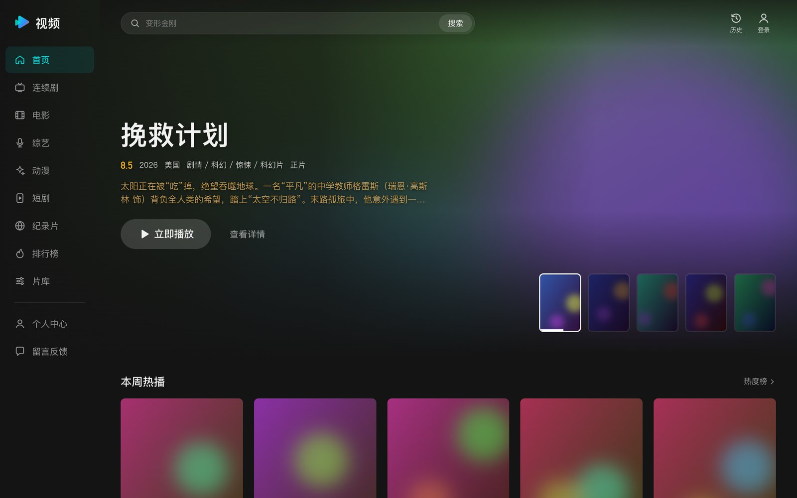
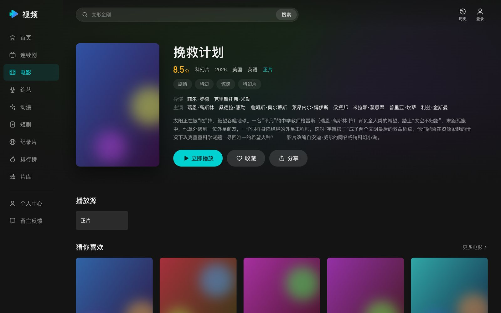
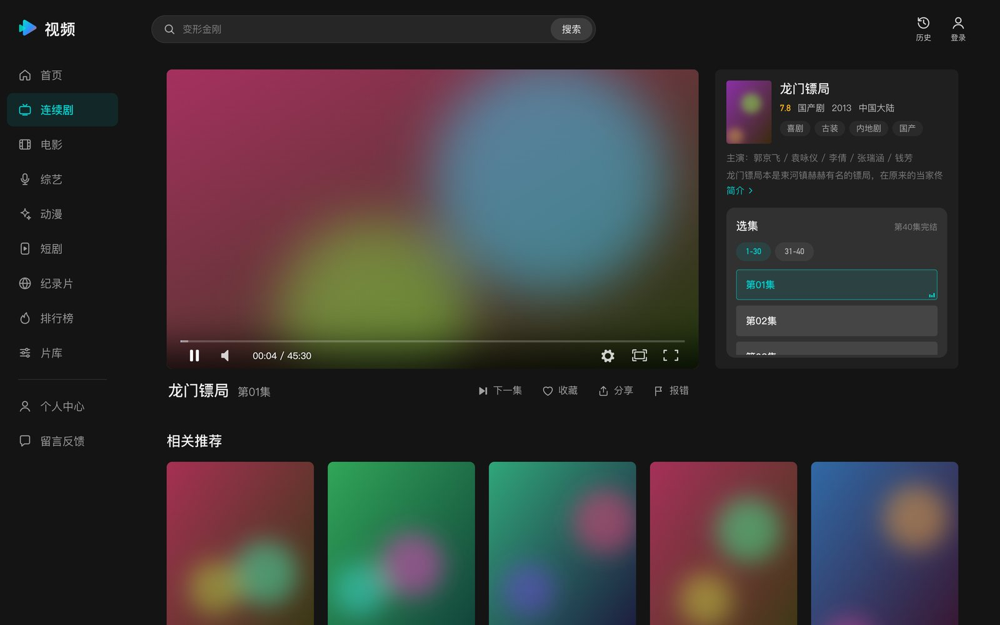
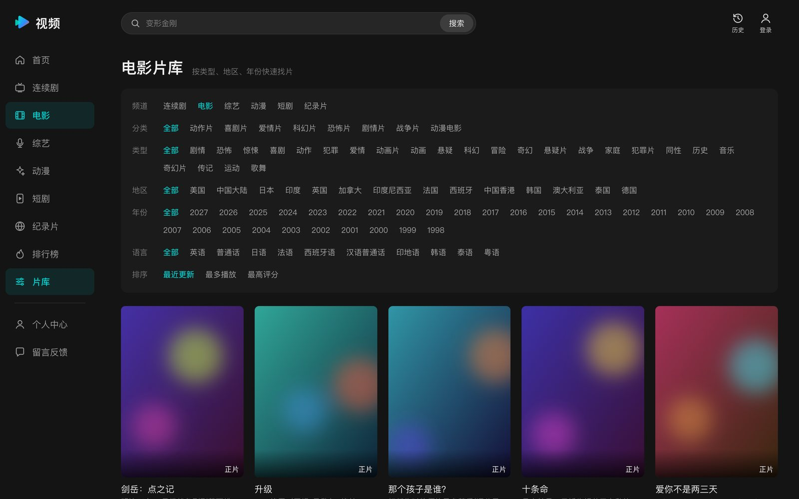
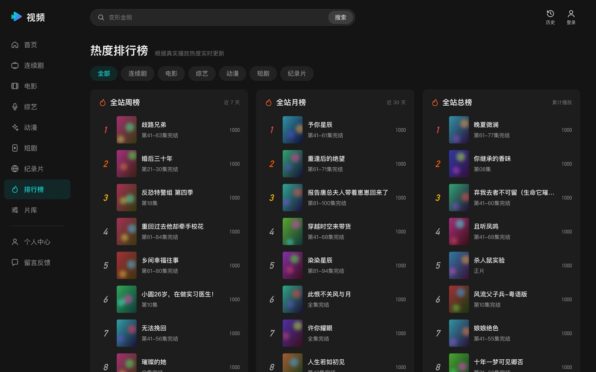
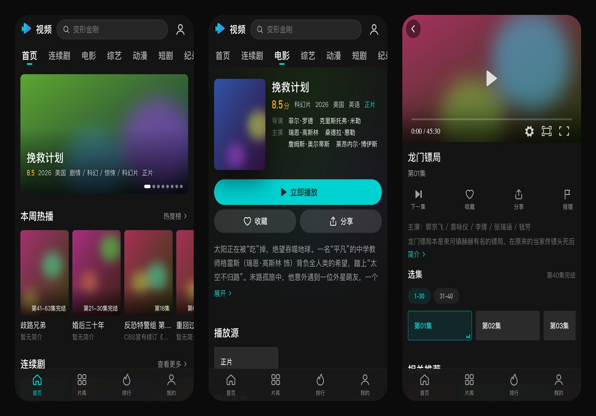

# TVideo · maccms10 深色视频主题

[](LICENSE)
[](https://github.com/zhoushun98/maccms-theme-tvideo/actions/workflows/check.yml)
[](https://github.com/magicblack/maccms10)

TVideo 是一套给 [苹果CMS（maccms10）](https://github.com/magicblack/maccms10) 用的深色前台主题，交互参考主流长视频平台。

- PC 和手机共用一套响应式模板。
- 不依赖构建工具和外部 CDN，复制到站点里就能用。



> 截图来自实际运行的站点，影片海报和剧照已替换为占位图。

## 特性

**布局与导航**
- 全站深色。
- PC 端：左侧竖排频道栏，顶部吸顶搜索栏。
- 手机端：频道横条加底部 Tab 栏，适配刘海屏安全区。

**页面**
- **首页**：焦点图、继续观看、本周热播、各频道分区。
- **片库**：可按类型、地区、年份、语言筛选，并支持排序；筛选项来自分类的扩展配置。
- **详情页和播放页**：
  - 选集每 30 集一组，切换线路时保持当前集数，支持上一集 / 下一集。
  - 附带相关推荐和评论区。
- **排行榜**：各频道的周榜、月榜、总榜。
- **其他功能**：
  - 搜索联想。
  - 继续观看（播放历史存在浏览器本地）。
  - 收藏、播放记录、PC 弹窗登录。
  - 会员中心、留言、评论、系统提示页都重新设计过。
- **未覆盖的模块**（文章、漫画、演员等）：统一显示「该栏目暂未开放」兜底页，不会因为缺模板而报错。

**播放器**
- 主题自带加载层和缓冲动画。
- 拦截 maccms 播放器向外站注入的预加载页、缓冲页和推广脚本（`union.maccms.la`）。
- 可选的 [DPlayer 增强补丁](#dplayer-增强补丁可选)：强制用 hls.js 播放加密 m3u8，并在 Safari 拦截自动播放时改为静音起播。

## 截图

| 详情页 | 播放页 |
| --- | --- |
|  |  |
| **片库筛选** | **排行榜** |
|  |  |

手机端（首页 / 详情页 / 播放页）：



## 环境要求

- **maccms10**：在 v2026.1000.4056 上开发和测试。其他版本的模板标签基本兼容，但没有逐一验证。
- **PHP**：版本与 maccms10 的要求一致（开发时用的是 PHP 7.4）。
- **浏览器**：近两年的 Chrome、Edge、Safari、Firefox，以及 iOS Safari 14 及以上。

## 安装

1. 下载本仓库（Release 压缩包或 `git clone`），把 `template/tvideo` 整个目录复制到站点根目录的 `template/` 下，文件属主与站点保持一致。
2. 在后台「系统 → 网站参数配置 → 基本设置」中：
   - 把「网站模板」和「手机模板」都选为 `tvideo`。本主题是自适应的，不需要单独的手机模板。
3. 在后台点「清理缓存」，或手动清空 `runtime/cache` 和 `runtime/temp`。
4. 推荐给 DPlayer 打增强补丁，见下文。

回滚时，把两个模板选项改回 `default` 即可。

## 使用说明

### 首页焦点图

- **取哪些影片**：推荐等级为 **9** 的影片，最多 8 部，按更新时间倒序。没有这样的影片时，改用本周热播的前 6 部。
- **横版大图**：读取影片的「海报图」字段（`vod_pic_slide`），建议尺寸 1920×1080。
- **没填海报图时**：用竖版封面配模糊背景展示。

### 频道与图标

侧栏和手机频道条显示视频模型（`mid=1`）的顶级分类，按分类排序，最多 10 个。

图标按分类的英文名（`type_en`）匹配，没匹配上的用通用图标。映射关系在 `html/public/sidebar.html` 里修改。

| type_en | 图标 |
| --- | --- |
| `dianying` | 胶片 |
| `lianxuju` / `dianshiju` | 电视 |
| `zongyi` | 麦克风 |
| `dongman` | 星芒 |
| `duanju` | 竖屏 |
| `jilupian` | 地球 |

### 片库筛选

- **取值来源**：依次查找当前分类的扩展配置（分类编辑页里的类型、地区、语言、年份），再到父分类，最后是「网站参数配置」里的视频扩展项（视频扩展分类、视频地区等）。
- **匹配方式**：maccms 对地区和语言做精确匹配，所以配置的取值必须和影片数据里的写法完全一致，否则筛不出结果。用采集数据时，建议先统计数据里实际出现的地区和语言，再填到配置里。

### 播放器

- **加载层**：播放器加载时，显示主题的加载层（模糊海报加转圈）。
- **缓冲动画**：播放中缓冲时，显示 `asset/player/buffer.html`。
- **拦截外站内容**：`asset/js/player-guard.js` 会在 maccms 的 `player.js` 之前运行，清掉后台配置的预加载 / 缓冲外站页面，并拦截推广脚本。
- **推荐用法**：m3u8 资源推荐用 DPlayer 播放。

### DPlayer 增强补丁（可选）

`tools/patch-dplayer.php` 会给 maccms 自带的 `static/player/dplayer.html` 打补丁，可以重复执行，也可以还原：

```bash
# 以站点文件的属主执行
sudo -u www-data php tools/patch-dplayer.php /path/to/maccms10
# 还原为原版
sudo -u www-data php tools/patch-dplayer.php /path/to/maccms10 --restore
```

| 补丁 | 解决的问题 |
| --- | --- |
| 强制 hls.js | 新版 Chrome 原生支持 HLS，DPlayer 因此改走原生播放，结果播不了 AES-128 加密的 m3u8。补丁让支持 MSE 的浏览器统一用 hls.js 播放。 |
| 缓冲层不拦截点击 | DPlayer 缓冲时插入的遮罩会盖住控制栏，导致缓冲期间无法暂停或拖动。 |
| 自动播放兜底 | Safari 默认拦截有声自动播放，DPlayer 被拒后直接暂停。补丁改为静音起播并提示「点击开启声音」；用户在页面上第一次点击或按键时，自动恢复声音。 |

补丁会做这些改动：
- 原版文件备份为 `dplayer.html.orig`。
- 给 `static/player/*.js` 里引用 `dplayer.html` 的地址加一个缓存参数，让浏览器拉取新页面。

maccms 升级覆盖播放器文件后，重新执行一次即可。

### 伪静态

开启或关闭伪静态都能正常使用，所有链接都通过 maccms 的 URL 函数生成。

## 目录结构

```text
template/tvideo/          主题目录，复制到站点的 template/ 下
├── info.ini              主题信息
├── html/                 模板（public/ 为公共片段，其余按 maccms 模块划分）
└── asset/
    ├── css/              main.css（公共）、play.css（详情/播放）、user.css（会员中心）
    ├── js/               tv.js（交互）、player-guard.js（播放器拦截）、trysee.js（试看）
    ├── img/              图标与占位图
    ├── player/           播放器缓冲动画页
    └── pwa/              自注销的 Service Worker，用来清掉默认主题遗留的 SW
tools/patch-dplayer.php   DPlayer 增强补丁
qa/                       Playwright 截图与播放验收脚本
docs/screenshots/         README 截图
```

## 常见问题

**页面显示「模板文件不存在」？**
maccms 遇到缺失的模板会直接报错，不会回退到默认主题。请提 issue，并附上出错页面的地址。

**新版 Chrome 播放 m3u8 黑屏，或报 `MEDIA_ERR_SRC_NOT_SUPPORTED`？**
资源是 AES-128 加密流，请打上面的 DPlayer 增强补丁。

**Safari 打开播放页没有声音？**
这是浏览器的策略：没有用户手势时，网页只能静音自动播放。打补丁后，在页面上点一下就会恢复声音。

**筛选项点了没有结果？**
地区和语言是精确匹配，见[片库筛选](#片库筛选)。

**首页焦点图没有横版大图？**
给影片设置推荐等级 9，并在「海报图」字段填上横版图。

## 参与贡献

欢迎提交 issue 和 PR。开发约定、maccms 模板引擎的注意事项和验收方法见 [CONTRIBUTING.md](CONTRIBUTING.md)。

## 免责声明

- 本项目只包含 maccms10 的前台主题（模板和静态资源），不包含、也不提供任何影视资源或采集接口。使用者应自行确保站点内容合法合规，使用本主题产生的一切后果由使用者自行承担。
- 界面设计参考了主流长视频平台的交互习惯。本项目与腾讯视频等任何平台无关，不包含它们的商标和素材。

## 许可证

[Apache License 2.0](LICENSE)。`template/tvideo/html/rss/` 下的模板复制自 maccms10 默认主题，详见 [NOTICE](NOTICE)。
